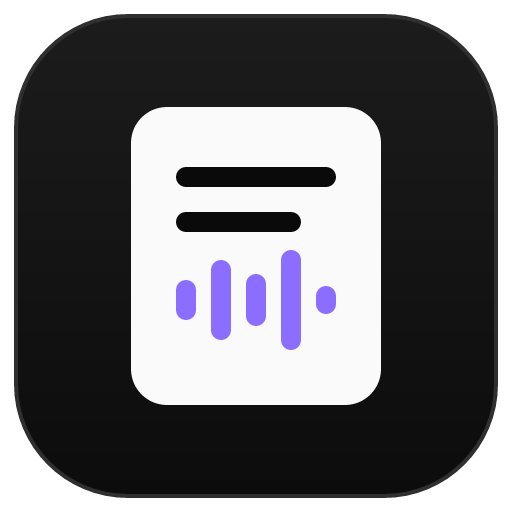
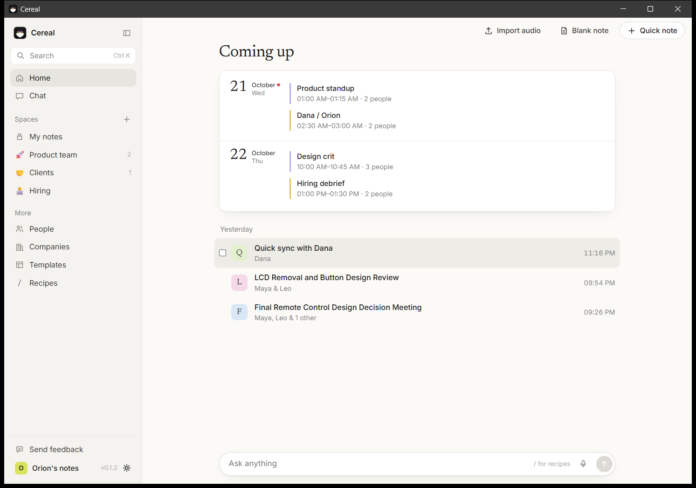
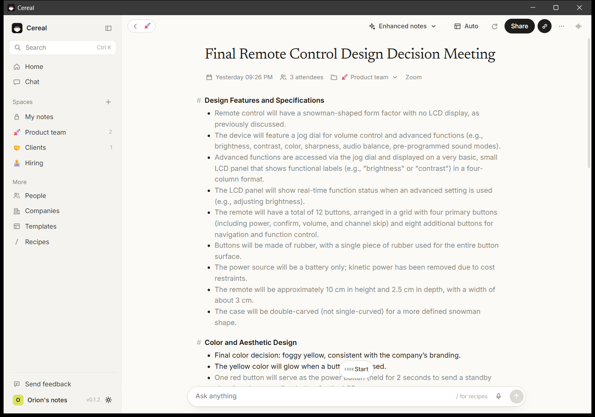

<p align="center"></p>

<h1 align="center">Cereal</h1>

<p align="center"><b>The free, local AI notepad for your meetings. No bot joins your call.</b><br>
Jot a few words during the meeting. When it ends, the AI on your computer turns them and the transcript<br>
into clean notes with decisions and action items. No account. No limits. Nothing leaves your computer.</p>

<p align="center"><sub>Inspired by  Granola<br>
Cereal is an independent open-source project and is not affiliated with or endorsed by Granola.</sub></p>

---

Cereal (formerly Toolbay Notes) is part of [Toolbay](https://toolbay.ai): free, open-source rebuilds of paid software.
It records **your microphone** (you) and **your computer's sound** (everyone else) as two tracks, so it works with Zoom,
Google Meet, Microsoft Teams, Slack huddles, Discord, Webex or a phone app without inviting anything into the call.
Speech recognition ([whisper.cpp](https://github.com/ggml-org/whisper.cpp)), speaker separation
([sherpa-onnx](https://github.com/k2-fsa/sherpa-onnx), pyannote segmentation) and the notes AI
([llama.cpp](https://github.com/ggml-org/llama.cpp) with an open Qwen model) all run on your own hardware.

<p align="center"></p>
<p align="center"></p>

Written from scratch (Tauri 2 + Rust + React). No code, assets or services from any commercial product are used.

## Install

**Windows 10/11:** download `Cereal_x.y.z_x64-setup.exe` from [Releases](https://github.com/sriptcollector/cereal/releases/latest)
and double-click it. No admin prompt, nothing else to install: the speech, speaker and notes engines and a starter speech
model are inside. Cereal picks the best AI models for your computer and fetches them in the background.

**macOS 13+:** download `Cereal_x.y.z_aarch64.pkg` (Apple silicon) or `_x64.pkg` (Intel) and open it. Cereal isn't
notarized by Apple yet, so macOS may say it's from an unidentified developer: System Settings › Privacy & Security ›
**Open Anyway**. Allow Microphone and "Screen & System Audio Recording" when asked (only the sound is used, never your
screen). Not yet tested on a real Mac. (The `.dmg` works too, but macOS calls a downloaded un-notarized app "damaged";
`xattr -dr com.apple.quarantine /Applications/Cereal.app` fixes that.)

**Through the Toolbay app:** find *Cereal* and click Install. One step, models included.

## How it works

1. A call starts. Cereal notices (Zoom, Meet, Teams, Slack, Discord, Webex, browser calls…) and starts taking notes,
   with a small floating indicator (Pause, Stop). Prefer to be asked? Settings › When a meeting starts.
   With a calendar connected, you also get a nudge a minute before each meeting.
2. The first time, it reminds you to tell the others (in many places everyone must agree to be recorded) and gives you
   a message to paste in the chat.
3. Type rough notes as the call goes. The live transcript fills in on the right.
4. When the call ends, Cereal stops by itself, re-transcribes at full quality, tells the other speakers apart, removes
   echo, and writes your notes with your template. Your own points stay dark; what the AI added is grey. Click the
   magnifier next to any line to see where it came from in the transcript.
5. Chat with one meeting, a folder, a person, a company, selected notes or everything (Ctrl+J), with sources. Search
   everything (Ctrl+K). Share as Markdown, Word, PDF or email, or auto-post a folder to Slack or any webhook.

Short calls with no talking are thrown away automatically.

**Speed** (RTX 4070 Ti, 44-minute 4-person meeting): transcript and speakers ready ~60 s after the call, notes ~22 s
later. CPU only (same PC): transcript written live during the call, notes ~9 minutes after.

## Features

- Two-track capture, no bot; live transcript; full-quality pass after the call; speaker separation; echo removal;
  auto-gain for quiet calls; follows device changes; never mutes other audio.
- Auto-detect and auto-record meetings (or ask, or do nothing), per-app rules and "ignore this app", auto-stop,
  false-alarm cleanup, always-visible indicator.
- Calendar via your private iCal link (Google, Outlook, iCloud): Coming up, pre-meeting nudge, prep briefs from past
  notes with the same people, notes titled with the event and its attendees.
- Granola-style notepad: Markdown, checkboxes, images (paste or drop), @mentions, `/` for templates.
- 26 templates (1:1, Sales call, Discovery, Stand-up, Interview, Retro, Board meeting…) plus your own, any as default.
- Chat with scopes and numbered citations, `/` recipes (12 built-in plus your own), voice questions, file attachments.
- Spaces: My notes and folders with icons, descriptions, files as chat context, auto-filing and webhooks; People and
  Companies views; Trash with 30-day restore.
- Import audio files (MP3, M4A, WAV, FLAC…) as notes. Export one note (Markdown, Word, PDF) or everything (CSV, JSON).
- Vocabulary, profile and notes language; transcript retention; light and dark; Toolbay account sync; in-app feedback.
- Your notes in other AI apps: a local MCP server (`cereal --mcp`, for Claude Desktop, Cursor…) and a CLI
  (`cereal notes list | get | transcript | search`). Send to Notion, log in HubSpot, post to Slack, with your own keys.
- Floating indicator with screenshot and live captions, Alt+Space quick chat, mini window, chimes, `cereal://` links.
- Automatic model choice; optional cloud engines with your own key. No telemetry.

The full checklist against Granola is in [docs/FEATURES.md](docs/FEATURES.md).

## Privacy

Audio, transcripts, notes and the search index live in your app data folder (`%APPDATA%\ai.toolbay.cereal` on Windows,
`~/Library/Application Support/ai.toolbay.cereal` on Mac). Network use: downloading AI models, your calendar feed,
Toolbay sync of settings/templates when signed in to the Toolbay app, feedback you choose to send, webhooks you set, and
a cloud engine only if you add your own key.

## Build from source

```bash
npm install
npm run tauri dev
```

`npm run tauri build` makes the installer. Tests: `cargo test --workspace`. See [AGENTS.md](AGENTS.md).

## License

MIT. whisper.cpp, llama.cpp and sherpa-onnx are MIT/Apache-2.0; Whisper models (MIT), Qwen3 (Apache-2.0), pyannote
segmentation 3.0 (MIT), 3D-Speaker CAM++ (Apache-2.0). Fonts: Newsreader and Inter (OFL).
